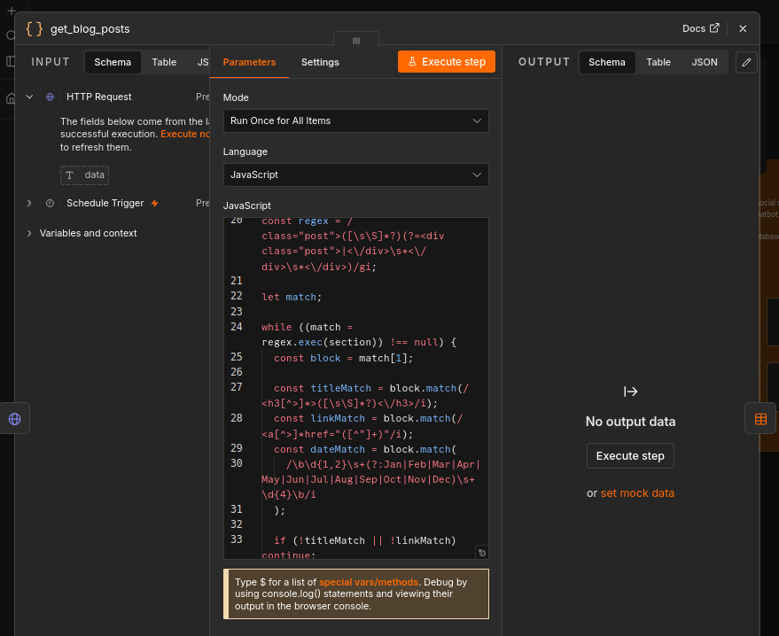
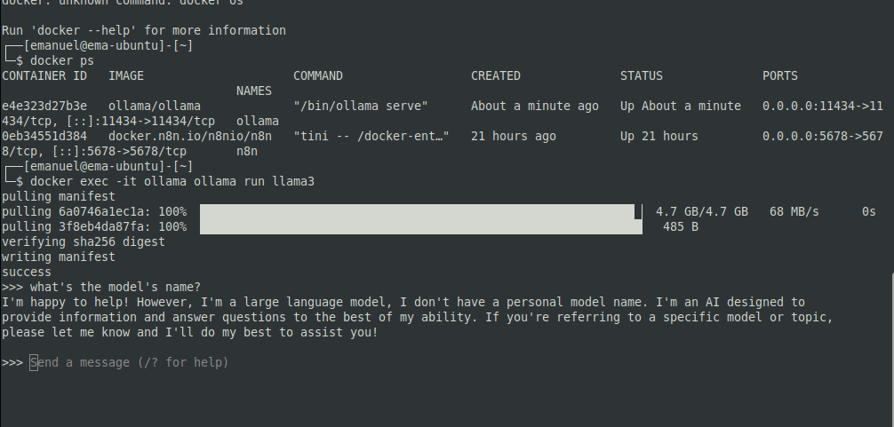
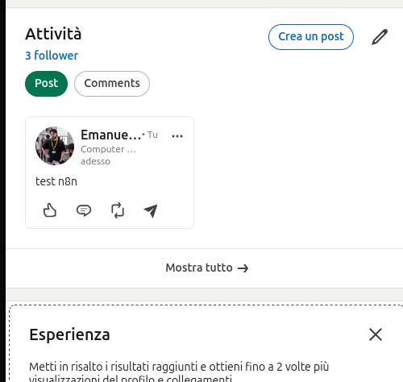
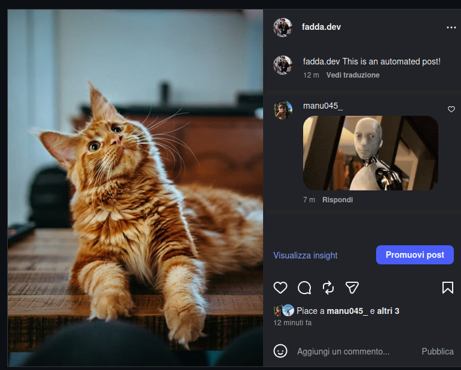
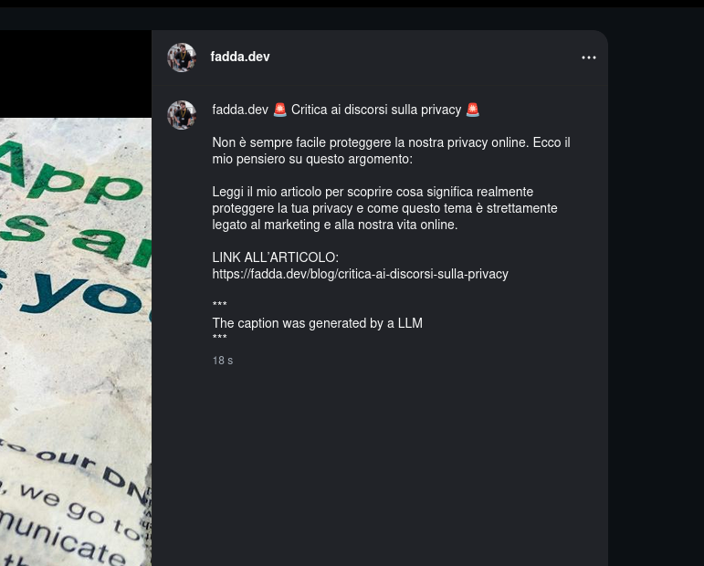
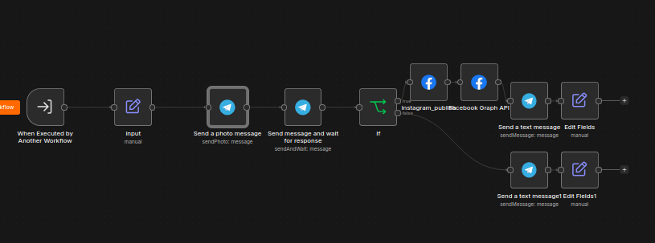

Qualche settimana fa ho iniziato ad approfondire Docker per un corso che sto seguendo, e ho pensato che sarebbe stato carino iniziare a giocare con le varie immagini distribuite in rete. 

Mi sono ricordato poi dell'esistenza di n8n, un software molto potente che permette la creazione di workflow anche abbastanza complessi.  

Una caratteristica molto interessante di n8n è che è molto integrata con servizi di diverso tipo, e quindi ci puoi fare diverse cose interessanti.

E così, siccome mi interessava costruire un modo per automatizzare l'invio di contenuti sui social, ho preso la palla al balzo e ho iniziato a fissarmi fino ad adesso che ho qualcosa di funzionante.

Solitamente sono abbastanza contrario all'abuso di intelligenza artificiale per la scrittura, credo fortemente nella trasparenza e nella sincerità sull'utilizzo di questi modelli sopratutto in ambiti creativi o quando si ha necessità di pensiero critico.

In questo caso l'AI mi farà da social media manager per il mio blog, tenendo un compito che è ripetitivo e non così complesso:  ovvero la scrittura di una caption dei miei post sui social. 

Inoltre ogni post prima della pubblicazione viene revisionato dal sottoscritto, quindi ho un certo controllo su quello che si pubblica.

Finiti i disclaimer, ora direi che possa passare al lato più tecnico.
<hr>

#### **Cosa fa il mio workflow?**

Il workflow riassumendo si divide in 3 fasi:

- 1) Controllare la presenza di nuovi post all'interno del mio sito internet. Se non ci saranno novità l'esecuzione si bloccherà.

- 2) Non appena verificato ciò, bisognerà guardare il contenuto dei nuovi post, ottenendo informazioni essenziali per fare in modo che il mio modello di intelligenza artificiale crei delle caption per i vari social network.

- 3) Per ogni social network (al momento, <a href="https://instagram.com/fadda.dev">Instagram</a> e <a href="https://www.linkedin.com/in/emanuel-fadda-2ab4ab43b/">Linkedin</a>), si prende la copertina di ogni mio post del blog, la si taglia in base al contenuto, e infine mi viene chiesto su Telegram la conferma di come verrà il post che sto per pubblicare.

##### **Fase 1**

Innanzitutto dovevo chiedermi come avrei dovuto tracciare i vari post?

Inizialmente ho pensato a un push sulla mia repository: per chi non lo sapesse il mio blog è hostato su Github, quindi le modifiche al sito vengono fatte attraverso i push sulla repository del mio sito.

Questa soluzione sarebbe stata la più "corretta" in quanto il workflow sarebbe partito non appena si sarebbe aggiunto un nuovo file all'interno della cartella dei post, e questo avrebbe implicato l'esistenza di un post nuovo 

L'informazione non sarebbe passata per intermediari e quindi sarebbe la più affidabile nel dirmi se effettivamente esista un nuovo post o meno.

Ho notato però alcune criticità nel metodo. Il motivo per cui ho cambiato piano è che l'intero processo si basa sul fatto che io voglia tenere a tutti i costi il sito su Github, cosa per niente ovvia in quanto andando avanti con il tempo mi convinco sempre di più di dover migrare il sito altrove.

Quindi nel momento in cui scelgo di non usare Github, l'intero workdflow sarebbe inutilizzabile. 

Ho cambiato approccio: basiamo l'intero processo sull'html del mio sito. Facciamo delle chiamate HTTP "GET" e usiamo le regular expression per ottenere la lista dei nomi dei miei articoli. Infine li salviamo su un database.

In questo modo mi permetto di non essere dipendente da Github, ma dalla struttura html del mio sito e dal nome di dominio (solo della parte "Blog" e della struttura delle pagine all'interno).

<div class="text-center px-2">
    
</div>

Il trigger che controllerà la presenza dei post è settata in orari precisi, quindi a un certo orario il workflow partirà autonomamente, i post verranno confrontati in base ai dati all'interno del mio database che tiene i post già esistenti. 

Se non ci sono ulteriori post, il workflow si fermerà, in alternativa andrà alla fase successiva.

##### **Fase 2**

Trovati i post, avrei ottenuto le informazioni sul testo del post nello stesso modo con cui avrei controllato se ci sarebbero stati post nuovi dentro il sito, HTTP GET + regular expression. Modo molto elegante per dire che ho fatto scraping.

Un qualsiasi LLM in rete è molto forte nella formulazione delle regular expression, e mi è stato d'aiuto nel parsing delle informazioni che ricercavo. 

Qui la vera parte complessa è stata come integrare l'AI per la creazione delle caption coerenti al post e al contesto. 

Ho tirato un secondo container Docker, usando Ollama come modello per la generazione di testo. Non essendo esperto di AI al momento volevo qualcosa di non troppo stupido che girasse su un portatile normale.

Mi è stato suggerito anche di cambiare il modello, in quanto ci sono modelli molto più performanti per questo scopo, ma al momento mi va bene così.

<div class="text-center px-2">
    
</div>

Il nodo non era per niente comprensibile, e ci ho messo molto tempo a cercare di capire come fare in modo che mi restituisse una struttura JSON coerente con quella che gli ho esplicitamente indicato. 

Il prompt cambia in base all'articolo, in input vengono dati testi e titolo dell'articolo a cui si fa riferimento e vengono restituite tutte le caption per ogni singolo social network

La struttura in output che ne uscirà è così:

```
"text_linkedin": {
    "type": "string"
},
"text_instagram": {
    "type": "string"
}
```

Il risultato generato inizialmente, verrà poi revisionato e ulteriormente corretto automaticamente per fare in modo che la risposta data rientra nella struttura indicata.

Nonostante abbia completato questa fase, ho notato ancora diverse cose da sistemare:

Innanzitutto ci sono casi in cui il modello si mette a fare caption in inglese, questo va contro alla lingua che ho dato nel prompt. 

Suppongo che ciò sia dovuto al fatto che se un post al suo interno, sopratutto quelli in ambito informatico, hanno molte parole in inglese, questo farà sì che il modello trovi più plausibile e coerente usare quella lingua.

Ho provato anche a regolare la temperatura del modello abbassandola (in parole spicce ho diminuito la probabilità con cui il modello si mette a improvvisare la parola successiva), sperando che non si sarebbe messo a parlare in inglese. E invece no.

Un altro problema poi, è che a volte, il container "ollama" si spegne automaticamente, quindi nel momento in cui il mio container "n8n" chiede una risposta, questo potrebbe non rispondere. 

Questo è facilmente risolvibile obbligando una dipendenza nel file "compose.yaml" tra i vari container, e assicurandomi un riavvio automatico in caso in cui il container si spenga.

##### **Fase 3**

Questa è stata la parte più divertente e complessa. 

Per tutto il percorso mi sono chiesto se effettivamente fosse davvero possibile mettermi e automatizzare il feed e se le API fossero accessibili per qualsiasi account.

La mia paura è che non essendo un "azienda" il processo di pubblicazione sarebbe stato impossibile. Inoltre non sapevo quale social automatizzare, e che tipologia di contenuto pubblicare.

Ho deciso di andare a step: ho provato a pubblicare un post su Linkedin, solo testo. Prima di fare ciò però dovevo assolutamente fare in modo che mi venisse mandata una bozza via Telegram. 

Ho creato il mio boot da cui mandare i messaggi è stato abbastanza semplice. La parte più particolare è stata la possibilità di mandare messaggi che permettessero una risposta "si" o "no".

Il problema è stato fare in modo che un qualsiasi host, che usa telegram con il mio account, e su qualsiasi connessione, possa dare l'informazione della risposta al mio portatile, per poter continuare la pubblicazione. 

Per fare questo si aveva bisogno di un "tramite" per ricevere i risultati della richiesta. Qui ho utilizzato un servizio di tunneling, chiamato Ngrok.

Per fare questo, mi sono fatto un account, creato un container con l'immagine 'ngrok' e settato gli indirizzi per il corretto funzionamento.

Quindi:

```
┌──────────────────┐       HTTPS        ┌──────────────────┐
│   Telegram API   │ ─────────────────► │   URL pubblico   │
│    (esterno)     │                    │      ngrok       │
└──────────────────┘                    └────────┬─────────┘
                                                 │
                                                 │
┌──────────────────┐       HTTP         ┌────────▼─────────┐
│  Container n8n   │ ◄───────────────── │  Container ngrok │
│    Porta 5678    │                    │                  │
└──────────────────┘                    └──────────────────┘
```

Finito il collegamento, è stato stato molto semplice anche creare i primi post su Linkedin, l'API era molto semplice da implementare.

Così siccome sono pigro e non volevo utilizzare altri account per la creazione dei post ho iniziato a fare i primi test sul mio Linkedin

<div class="text-center px-2">
    
</div>

Instagram invece è stato molto più difficile. L'API di Facebook non è per niente semplice da utilizzare, dopo 2 giorni di tentativi falliti ho deciso di cercare dei tutorial su Youtube (e io odio i tutorial su Youtube).

Alla fine sono riuscito a pubblicare il mio primo post, con testo e immagine preimpostati.

<div class="text-center px-2">
    
</div>

Anche le foto mi hanno obbligato a fare qualche step in più, dovevo decidere prima di tutto, che immagini mettere. 

Per semplicità ho deciso di usare le immagini copertina di ogni mio articolo che si trovano all'inizio dopo il titolo. 

Poi dopo averle anche prese e tagliate, avrei dovuto trovare un modo per esporre quelle foto in rete: infatti le API di Telegram e Instagram necessitano del link pubblico per ottenere la foto da usare.

Qui ho usato ImageKit, servizio simile a ngrok, ma specializzato per portare online le immagini. Prima del processo di richiesta di pubblicazione, si crea un link in cui si espone l'immagine del post, finita la pubblicazione del post sul social, il link si chiude.

Questo processo poi è stato replicato pure per Linkedin, permettendo l'aggiunta delle foto insieme al testo. Per ogni branch è stato poi messo un subworkflow, per rendere la lettura e il debug del workflow molto più immediato.

<div class="text-center px-2">
    
</div>

Infine i risultati dei due rami (quelli inerenti alla pubblicazione dei post), sarebbero stati uniti per inserire i dati all'interno del database iniziale, così in caso di assenza di nuovi post non si sarebbero creati post inerenti a vecchi articoli già processati nel workflow.

<div class="text-center px-2">
    
</div>

E se in uno dei due social decidessi di annullare l'invio del post? 

Domanda che mi sono posto un po' troppo avanti, forse si sarebbero potute trovare soluzioni migliori ma al momento ho preferito non gestire questo caso. 

Sicuramente in futuro potrò pensare di richiedere autonomamente via telegram, la correzione oppure la rialaborazione del post con ollama.

<hr>

#### **Conclusioni**:

Al momento sono abbastanza soddisfatto del risultato ottenuto. 

La vera prova finale sarà la pubblicazione di post inerenti a questo articolo che sto scrivendo ora, con caption e immagine inerente. 

Farò ulteriori correzioni mentre pubblicherò questo post, in quanto il blog non è molto popolato e quindi ho usato come test due soli articoli, ovvero quelli già presenti sul sito. 

Inoltre potrei pensare in futuro di aggiungere nuovi nodi, che implementano nuove funzioni e arricchiscono quello che è il workflow attuale, magari aggiungendone di ulteriori.

Ho scoperto poi che online si possono trovare workflow che hanno lo stesso scopo e probabilmente sono stati fatti con meno fretta e molto meglio. 

Nonostante ciò ho voluto continuare lo stesso perchè volevo comprendere quanto effettivamente fosse semplice la creazione di contenuti creati con l'intelligenza artificiale. 

Non ho mai realizzato appieno quanto i social network siano così tanto automatizzabili e come i contenuti che vediamo ogni giorno possano essere una finzione e non frutto di una persona reale. 

È stato divertente sperimentare queste cose. Nutro passione su come le persone interagiscono con le macchine nei social media. Questo non significa terrei a vita questo workflow, ma non mi dispiacerebbe creare programmi che abbiano funzionalità simili.

